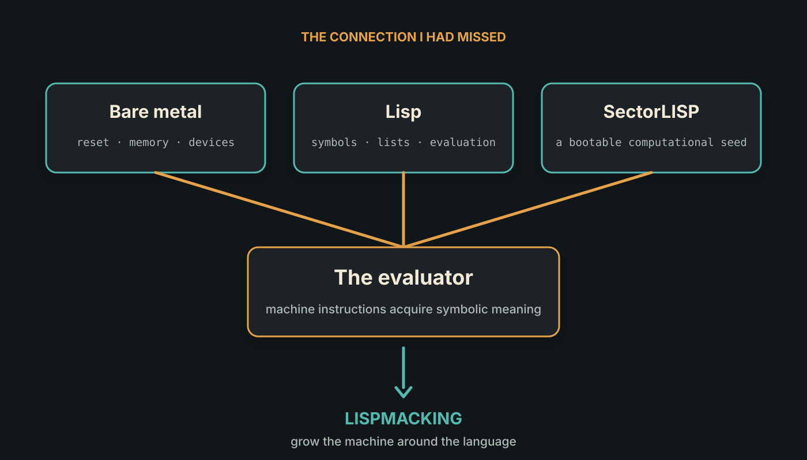

<!--
title: Bare Metal Enlightenment
subtitle: How "What is so cool about SectorLISP?" turned into Lispmacking OS
status: substantial draft
hero: ../assets/artwork/lispmacking-series-hero.png
reading_time: 7 minutes
-->

# Bare Metal Enlightenment

I am familiar with Lisp, having programmed a little bit in Scheme and Common Lisp. I also know Lambda Calculus from my tryst with functional programming. I have done a fair bit of bare metal programming in C and different families of assembly. So I have a good understanding of how bootstrapping works for operating systems and programming languages.

Many, many years ago I had read about SectorLISP and was awed by its tiny footprint of a few hundred bytes. I knew that writing anything substantial and useful, even in raw assembly, would result in much larger code. Only my LED blinking 101 programs were shorter than SectorLISP.

So I recently wondered: "What is so cool about Sector LISP?"


## What is so cool about SectorLISP?

I put the question to ChatGPT. Its answer started with a comparison that put
my LED programs in their place: a Lisp with a garbage collector could take up
less space than an empty modern word-processing document.

The [436-byte version](https://justine.lol/sectorlisp2/) fits into a 512-byte
boot sector. The BIOS loads it and hands over control. You can then enter
Lisp expressions without first booting an operating system.

That is a lot to fit into the space where I would normally expect just enough
code to load something larger. I understood why the size was impressive. What
needed a little more thought was what you could do once that Lisp was running.

## A few hundred bytes, then what?

The [SectorLISP repository](https://github.com/jart/sectorlisp) has three useful
pieces to look at together: the bootable i8086 implementation, a readable C
reference implementation, and an evaluator written in Lisp. The native
implementation can run that Lisp-written evaluator, which can in turn
evaluate another Lisp program.

This is where Lisp's habit of representing programs as lists becomes useful.
The evaluator written in Lisp arrives as ordinary input. It does not need to
be squeezed into the boot sector along with the native evaluator.

The small language underneath needs atoms, cons cells, quotation, conditionals
and function application. Operations such as `car`, `cdr` and `cons` let it
inspect and build lists. That is enough to express the next evaluator. It is
a very small Lisp, of course; nobody is claiming to have fitted Common Lisp
into a boot sector.

The byte count got my attention. Running another evaluator on top of those
bytes gave me something to think about.

## The connection I had missed

In bare metal programming, I expect to spend time on stack pointers, memory
maps and device registers before anything interesting happens. A program can
fail before it has a way to tell you what went wrong. Getting an LED to blink
is useful precisely because it tells you that at least some of this is working.

Lisp feels a long way from that. You enter an expression, inspect a list, apply
a function. The machine is still doing the work, but you get to think in terms
of the program rather than the registers holding it.

SectorLISP puts these two experiences very close together. A few hundred bytes
of native code are enough to get from the boot sector to evaluating symbolic
expressions. After that, some of the work of building the environment can
happen in Lisp itself.

I already knew about bootstrapping operating systems and languages. What I had
not quite connected was how early the language could become useful in building
the rest of the system. You could start with a small evaluator and gradually
give it the tools to work on the machine around it.

That seemed like something worth trying.

## This is how Lispmacking started

The question became fairly practical: what would we need to add to a small
Lisp to start building an operating environment with it?

That experiment is **Lispmacking**. We chose 64-bit RISC-V on QEMU's `virt`
machine, with room to make the implementation readable and easy to inspect.
SectorLISP's byte budget is impressive, but I had enough questions without
also trying to save every last byte.

We started with the familiar bare metal chores. Set up a stack, clear the
uninitialised data, and write something through the serial port. Our equivalent
of the blinking LED was:

```text
Lisp machine booted.
```

There was no Lisp at that point. The message was a little ahead of the
implementation.

Next came a small evaluator in C. We made the same evaluator run both as a
normal program on the development machine and as a bare-metal program in QEMU.
That gives us a convenient place to test the language, and a second place to
check that it works with our own allocator and serial console. The language
code is shared; the allocation and I/O adapters change.

To let Lisp do useful work with the machine, we added integers, checked
arithmetic, page allocation and bounded memory access. Operations that reach
machine state have a conspicuous `bootstrap:` prefix. These are privileged
tools for bringing the system up. Naming them separately makes that authority
visible, though the name itself provides no isolation.

With those pieces in place, we could write an assembler and a restricted
compiler in Lisp. They calculate RISC-V instruction words and write them into
a code page. We can then call the generated function on the emulated CPU.

There are two kinds of execution here, and it is easy to mix them up. The C
evaluator still interprets the Lisp compiler. The function produced by that
compiler runs as native RISC-V instructions. We have taken a step towards
bootstrapping more of the system in Lisp; we have not compiled away the C
evaluator.



*The stack on the left shows what supports the Lisp tools. The path on the
right shows where their generated code goes. Everything inside the emulated
machine still runs with machine-mode authority.*

## How much of an OS is this?

At the moment, there is quite a bit left to build. The evaluator is written in
C, and its allocator keeps handing out memory without reclaiming it. Restarting
the machine is our current way of getting that memory back. Generated code
pages remain writable, and all bare-metal execution happens in RISC-V machine
mode, with access to privileged machine operations.

The checks around a native call can reject a bad entry address. They cannot
stop a function from doing damage once it starts running. We have no process
isolation, page tables, capabilities or user-space drivers yet. So the
microkernel in the project description is still a goal.

The next substantial experiment is to run two isolated Lisp environments on
the same machine. Each should have its own memory and be able to communicate
with the other only through an endpoint it has been explicitly given. Getting
there means adding page tables, privilege transitions, traps, scheduling and
capability-controlled communication.

After that, we want to move facilities such as the console and device drivers
into separate services. A VirtIO device will give us a concrete operation to
try. The small privileged core should enforce access and communication; the
services should decide what useful work to do with them.

There is plenty of work between the current serial prompt and that system.
The useful thing is that we now have somewhere to start experimenting.

## Back to the original question

I came back to SectorLISP wondering about its tiny footprint. What I took away
was a way to connect two things I had worked with separately: bringing a
machine up from bare metal, and building programs in Lisp.

An evaluator can be an early part of bringing up the machine. Once it works,
the language becomes another tool for building what comes next. Lispmacking
is our attempt to see how far we can take that idea.

The next article starts with the part before any of the Lisp worked: getting
QEMU to print that slightly premature greeting.
