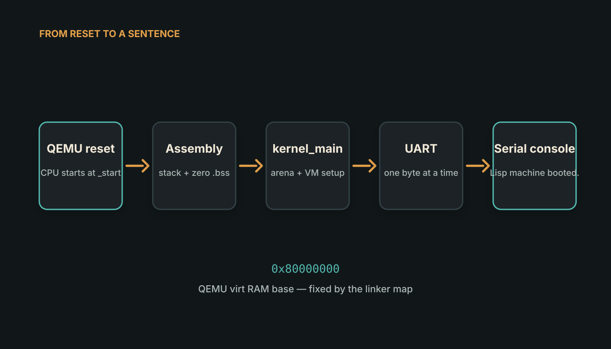

<!--
title: It from Bit
subtitle: Building a Lisp machine by first teaching a RISC-V CPU to say hello
status: substantial draft
hero: ../assets/artwork/lispmacking-series-hero.png
reading_time: 5 minutes
-->

# It from Bit

At the beginning, our Lisp machine did not know any Lisp.

It could not add two numbers. It had no objects, no garbage collector, no
prompt and, strictly speaking, no operating system. Its complete vocabulary
was one sentence:

```text
Lisp machine booted.
```

That does not sound like much of a machine. It was nevertheless the first
important result, because the sentence came from a RISC-V CPU with nothing
underneath our program—not macOS, not Linux, not even a C library.

The interesting part of starting from nothing is discovering how much
“nothing” contains.

## Before `main`

Most programs begin inside a convenient fiction. We write `main`, and an
operating system loads the executable, creates a process, maps memory, prepares
a stack and points the CPU at some startup code. Even C performs a small piece
of theatre before our first line runs.

A bare-metal image does not get that theatre. QEMU creates an emulated RISC-V
machine and places our kernel in RAM, but the first instruction is ours. If the
stack pointer contains nonsense, a normal function call can corrupt memory. If
the uninitialised-data section still contains old bytes, a global variable that
should start at zero may begin life as something else.

So our first useful program had to do three things before it could behave like
a C program:

1. establish a stack;
2. clear the `.bss` section;
3. call `kernel_main`.



*The first abstraction boundary is not Lisp versus machine code. It is the
small assembly path that creates the conditions expected by C.*

The linker places the image at `0x80000000`, the RAM base of QEMU's `virt`
machine. A linker script also gives names to the ends of `.bss` and the stack.
The assembly entry point walks over `.bss`, stores zeroes, installs the stack
pointer and finally crosses into C.

There is no mystery in any one instruction. The mystery only appears when an
operating system normally performs all of them for us.

## A sentence has to go somewhere

Calling `kernel_main` still does not give us `printf`. In a normal process,
standard output eventually becomes a system call. Here there is no system to
call.

QEMU's `virt` machine includes a small 16550-compatible UART. The UART exposes
registers at known memory addresses. Writing a byte to the transmit register
causes that byte to appear in QEMU's serial console.

The entire first output path can therefore be summarized as:

> store a byte at the UART's transmit address, wait until the UART is ready,
> and repeat.

That sentence is less comfortable than `printf("hello")`, but it is much more
revealing. Output is not a language feature. It is an agreement between code
and a device.


*The image above is rendered from an actual `make test-qemu` transcript; the
plain text is stored beside it.*

## Why start with QEMU?

We could have started with a physical RISC-V board. That would also have added
power supplies, flashing tools, board-specific boot firmware and the
possibility of an incorrectly connected serial cable.

QEMU lets us keep the machine boundary while removing those unrelated
variables. The CPU instructions are RISC-V instructions. The kernel is an
RV64 ELF. UART access uses memory-mapped registers. We can attach GDB to the
emulated CPU and inspect the first instruction.

What QEMU does *not* make this is a hosted program. There is still no operating
system below the image. QEMU is emulating the hardware from outside the
machine, not supplying process services from inside it.

That distinction will matter later, when the same Lisp evaluator runs in two
places: once as an ordinary host process and once as the only program on this
emulated computer.

## The value of a tiny result

It is tempting to race past boot code because it does not look like the Lisp
machine we set out to build. But the one-sentence machine established several
facts we would otherwise have mixed together with later bugs:

- the cross-compiler produces a valid RV64 executable;
- the linker puts code and data where QEMU expects them;
- the stack supports normal function calls;
- uninitialised storage really begins at zero;
- the kernel can communicate through the serial device;
- GDB can stop the CPU at source-level symbols.

Once those facts were boring, the next failure could belong to the evaluator
rather than to the boot path.

This is a recurring theme in the project. We are not trying to make the
smallest possible artifact. We are trying to make every new layer small enough
that, when it breaks, there are only a few places to look.

Our machine could now say one sentence. The next question was stranger: could
we teach it a language without maintaining two implementations of that
language?
