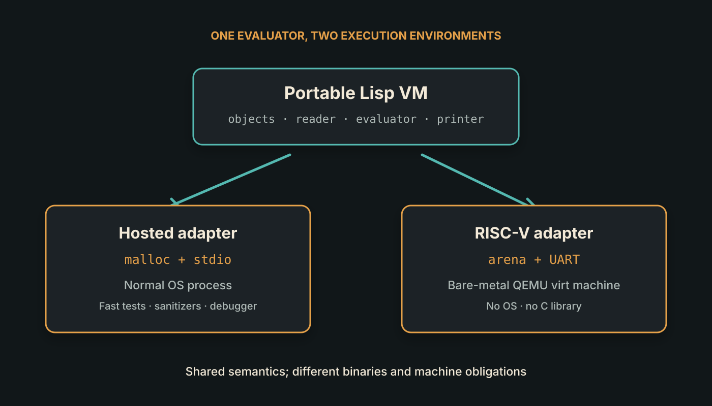
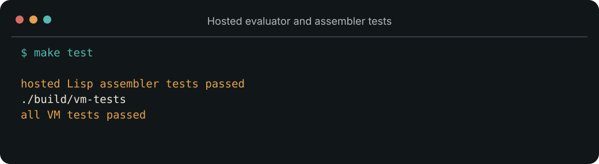

<!--
title: One Lisp, Two Universes
subtitle: The same evaluator inside an operating system and on a machine with no operating system
status: substantial draft
hero: ../assets/artwork/lispmacking-series-hero.png
reading_time: 5 minutes
-->

# One Lisp, Two Universes

We wanted a Lisp evaluator on a bare RISC-V machine. The obvious way to test it
was to rebuild the kernel, start QEMU, type an expression into the serial
console and see what happened.

That was also a very slow way to discover that `cdr` had been given an atom.

Bare-metal execution is valuable precisely because it removes the operating
system. It also removes the comfortable tools the operating system gives us:
fast process startup, sanitizers, ordinary files, mature debuggers and cheap
test isolation. If every language bug had to travel through a cross-compiler
and an emulated UART, the machine would be pure but development would be
needlessly ceremonial.

So we made one evaluator inhabit two universes.

## The part that is actually Lisp

The evaluator is a small portable C11 core. It implements tagged objects,
symbols, cons cells, environments, the reader, evaluator and printer. Its
important objects do not know whether they live in a macOS process, a Linux
process or bare RAM attached to an RV64 CPU.

That claim requires a little discipline. An innocent call to `malloc` would
make the core depend on a C library. An innocent `printf` would make output
depend on standard I/O. Instead, the VM receives allocation and byte-output
operations through a small platform interface.



*The evaluator is shared source, not a shared executable. Each environment
compiles it with a different entry point and adapter.*

On the hosted side, allocation means `malloc`, output means `stdio`, and the
operating system launches `main`. On the bare-metal side, allocation means
moving a pointer through a fixed arena, output means writing UART registers,
and assembly code creates the first stack.

The two programs are not identical binaries. They are two binaries that agree
on what a Lisp object and a Lisp expression mean.

## A very small Lisp

The first language did not aim at Common Lisp compatibility. It had symbols,
`nil`, cons cells, quotation, `atom`, `eq`, `car`, `cdr`, `cons`, `cond`,
lexically scoped lambdas and application.

That is enough to make the following expression interesting:

```lisp
(((lambda (x)
    (lambda (y)
      (cons x (cons y nil))))
  'a)
 'b)
```

The result is `(a b)`. More importantly, the inner lambda still remembers
`x` after the outer lambda has returned. The evaluator therefore has lexical
closures rather than a parser that merely recognizes Lisp-shaped text.

The hosted build lets us test that behaviour as an ordinary program:



*The hosted path is where memory checks, rapid unit tests and debugging belong.
It does not replace the bare-metal proof.*

Once the evaluator was stable there, we compiled those same VM source files
for RV64, attached the arena and UART adapter, and placed a serial read-eval-
print loop in `kernel_main`.

The expression now travelled a very different path—UART bytes instead of
standard input, arena objects instead of heap allocations—but reached the same
semantic result.

## Portability is a boundary, not a slogan

It would be easy to say the project is “platform independent”. It is more
useful to say exactly what moves and what does not.

The reader and evaluator are intended to move. The RV64 startup assembly does
not. QEMU's UART address does not. The linker map does not. Porting the hosted
program to another Unix-like system mostly requires a C compiler. Porting the
bare-metal program to another board requires a new startup path, memory map and
console adapter.

This is not a failure of portability. It is the definition of the portability
boundary.

The same honesty applies to C. At this stage the evaluator is written in C,
and that is useful. C gives us a compact implementation that can run both with
and without an operating system. Lisp is the language *being implemented*;
later, selected pieces of the system can move into Lisp when Lisp is capable of
hosting them.

Trying to remove C on day one would not remove the bootstrap problem. It would
only hide the bootstrap in a less mature toolchain.

## The first conversation

With the serial REPL, the machine could finally do more than announce that it
had booted:

```text
Lisp machine booted.
lisp> (cons 'a '(b c))
(a b c)
lisp> (cond ((eq 'a 'b) 'wrong) (t 'right))
right
```

There are two different achievements in this unremarkable transcript.

The first is a language achievement: reading, evaluating and printing work
together. The second is a systems achievement: the same core survived removal
of the host operating system.

Neither proves that we have a Lisp operating system. The evaluator still runs
entirely in RISC-V machine mode. It cannot isolate one program from another.
Its arena never reclaims objects. UART input polls in a loop. A malformed or
hostile machine operation would have the authority of the kernel itself.

But now we had somewhere to stand. The hosted universe could answer language
questions quickly. The bare-metal universe could answer machine questions
honestly.

The next step was to let Lisp ask some of those machine questions—starting
with integers and addresses—without handing every expression unrestricted
control of the computer.
