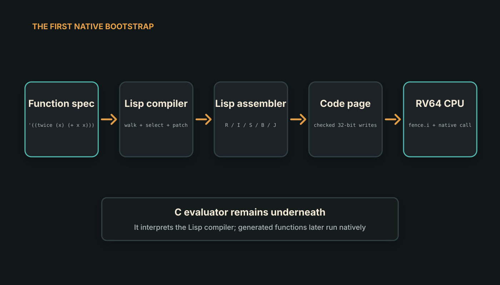
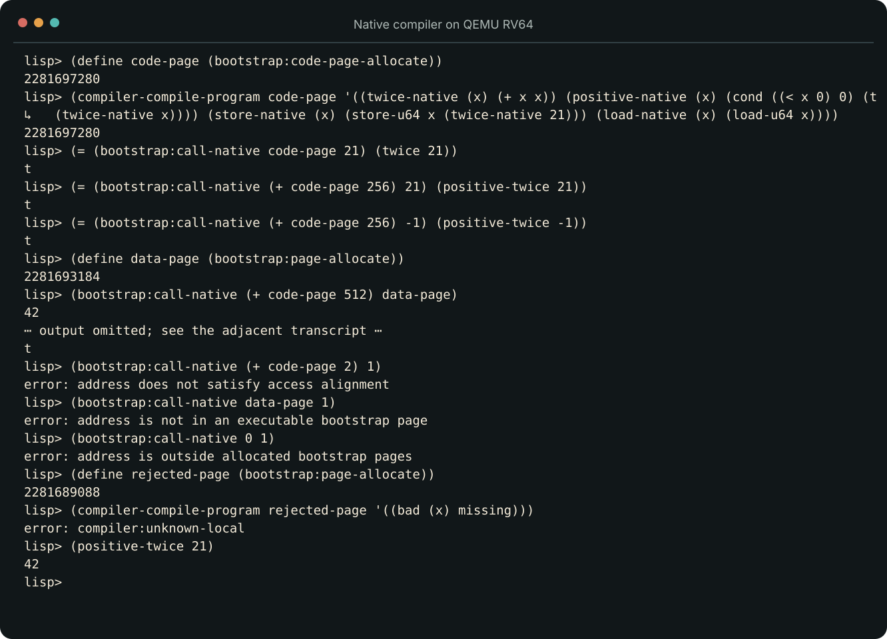

<!--
title: The Day Lisp Wrote a RISC-V Instruction
subtitle: From an interpreted function to native machine code, on the same tiny system
status: substantial draft
hero: ../assets/artwork/lispmacking-series-hero.png
reading_time: 6 minutes
-->

# The Day Lisp Wrote a RISC-V Instruction

At one point our Lisp machine evaluated this function in C:

```lisp
(lambda (x) (+ x x))
```

Later, on the same boot, Lisp translated the function into RISC-V instruction
words, wrote those words into memory and asked the processor to execute them.
The answer came back as the integer `42`.

This is the sort of result that invites an imprecise sentence: “the Lisp
machine became self-hosting.” It did not—not yet. The evaluator was still C,
and the compiler itself was being interpreted by that evaluator.

What happened was narrower, and perhaps more interesting: Lisp acquired the
ability to manufacture a small piece of native code and cross a controlled
boundary into it.

## An instruction is an integer with obligations

Consider the RV64 instruction:

```asm
addi a0, a0, 1
```

The processor does not see that text. It sees a 32-bit word whose fields name
an opcode, destination register, source register and signed immediate. For
this instruction the word is `0x00150513`, or `1377555` in decimal.

By Milestone 4, our Lisp had signed 64-bit integers, arithmetic, comparison,
division and remainder. That was enough to calculate the bit fields of an
instruction. A Lisp function could validate an immediate, shift the component
values into place and add them together.

We implemented encoders for the R, I, S, B and J formats, then exposed a small
instruction vocabulary: `addi`, `add`, `sub`, `mul`, `slt`, `ld`, `sd`,
`beq`, `jal` and `jalr`.

The hosted tests compare representative words with encodings produced
independently by the GNU RISC-V assembler. That matters. If the encoder and
its test shared the same mistaken formula, agreement would prove very little.

## Writing code is not the same as executing it

Generating the integer `1377555` is harmless. Storing it at an arbitrary
address and jumping there is not.

The machine interface therefore distinguishes an ordinary data page from a
code page. Lisp requests a bounded 4 KiB bootstrap code page. Writes are
checked against allocated pages. A native call accepts only a four-byte-aligned
entry address inside a page explicitly marked as executable.

Before the call, the RISC-V adapter executes `fence.i`. Without it, the CPU's
instruction view of memory is not required to notice bytes that were just
written through the data path.



*The C evaluator remains below the compiler. The new bootstrap step is the
Lisp-written assembler and compiler above it.*

The boundary rejects misaligned addresses, addresses in ordinary data pages
and addresses outside the bootstrap pool. This does not make generated code
safe. Code pages remain writable, and native code still runs in machine mode.
It does turn several easy accidents into recoverable Lisp errors.

## A compiler small enough to inspect

The compiler accepts a quoted list of function specifications:

```lisp
(compiler-compile-program code-page
  '((twice (x) (+ x x))
    (positive (x)
      (cond ((< x 0) 0)
            (t (twice x)))))))
```

Each function has one argument and one expression body. The body may contain
small integer literals, the argument, `+`, `-`, `*`, `<`, a two-clause `cond`,
calls to other compiled functions, and explicit 64-bit loads and stores.

These restrictions are not an attempt to design a fashionable tiny language.
They keep the first native compiler auditable. One 4 KiB page holds sixteen
fixed 256-byte function slots. Because every function's address is known from
its slot, calls can use PC-relative `jal` instructions even when the target is
compiled later.

Generated functions use a small, documented ABI. The argument arrives in
`a0`; the result leaves in `a0`; `s0` preserves the source parameter; `ra` and
`s0` are saved in a 16-byte-aligned stack frame. Expression temporaries also
reserve aligned stack space.

There is no register allocator. There is no optimizer. There is no pretence
that this is a general Lisp compiler. There is a complete path from syntax to
instructions that a person can follow in an afternoon.

## The branch that does not exist yet

Conditionals expose a small compiler problem. When we emit the branch at the
start of a `cond`, we do not yet know how many instructions its first arm will
contain. The branch offset does not exist until later.

The compiler first emits a placeholder. After both arms have known positions,
Lisp revisits that word and replaces it with a B-format branch containing the
real displacement. It performs the same sort of patching for the jump over the
second arm. Calls are resolved against the fixed function slots.

This is relocation in miniature: emit something structurally valid, discover
where the destinations landed, then patch the relative distances.

## What actually ran

The QEMU acceptance test starts from a fresh boot. It streams the assembler
and compiler source into the serial REPL, allocates a code page, compiles four
functions and calls them through the native boundary.

The native functions exercise arithmetic, a conditional branch, a call from
one generated function to another, and 64-bit memory loads and stores. Their
results are compared with results from the evaluator. Invalid entry points are
also attempted and rejected. Finally, control returns to the REPL and QEMU
exits cleanly.



*The important result is not merely “42”. It is that generated calls, branches
and memory operations ran on the emulated RV64 CPU and returned through the
documented ABI.*

So what do we have now?

We have a C evaluator that can interpret a Lisp compiler. We have a Lisp
compiler that can emit a deliberately small subset of native RV64 functions.
We have a bounded mechanism for executing those functions. We do not have a
compiler for the whole language, a garbage-collected native runtime, write-
exclusive-or-execute memory, or a privilege boundary.

That last omission is the next important one. Bare metal can feel like an
operating system, and native code can feel like completion, but everything is
still equally privileged. Before this project deserves the word
“microkernel”, the machine has to learn how to say no.
